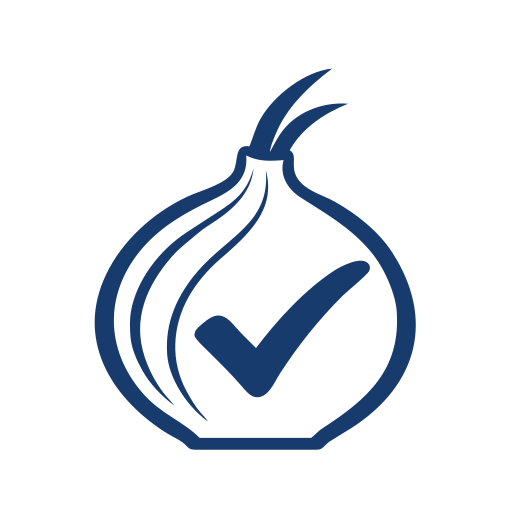

<picture>
  <source media="(prefers-color-scheme: dark)" srcset="assets/branding/check-tor-reverse.svg">
  
</picture>

# Tor Reachability Scanner

`check_tor` sends automated requests through a local Tor proxy and reports what
happened, including HTTP refusals, challenge-like responses, and connection
failures. If a result such as a refusal or timeout persists, the scanner can
compare the outcome with a second request outside Tor. Use Tor Browser to
check whether a person can load a page or complete a task. Curl and Tor Browser
can receive different responses or handle the same response differently.

`check_tor` is an independent volunteer project by a Tor donor and fan. It is
not affiliated with or endorsed by [The Tor Project](https://www.torproject.org/).

## Run your first scan

From a checkout of this repository, install and start Tor for your platform.
The scanner needs Zsh and curl on `PATH`, plus the standard utilities `awk`,
`grep`, `head`, `cut`, `tr`, `wc`, and `mktemp`.

**macOS with Homebrew**

```zsh
brew install tor
brew services start tor
```

**Debian or Ubuntu, including a ChromeOS Linux environment that runs services**

```zsh
sudo apt update && sudo apt install zsh tor curl
sudo service tor start
```

The default SOCKS address is `localhost:9050`. Keep the files in the checkout
together so the entry point can load its helper files. Put your target list in
a private directory outside the repository.

```zsh
umask 077
mkdir -p "$HOME/tor-targets"
cp -i targets-EXAMPLE.txt "$HOME/tor-targets/mylist.txt"
```

Edit the copy with your preferred editor. Supply one readable file with a
domain or URL on each line. The scanner trims whitespace, skips blank lines
and lines beginning with `#`, and rejects a list with no targets. It adds
`https://` to bare targets and upgrades an initial `http://` to `https://`.
Curl can then follow redirects from that starting URL.

Run the scanner with your target list:

```zsh
./check_tor.zsh "$HOME/tor-targets/mylist.txt"
```

Curl verifies HTTPS certificates using its configured trust store. Keep curl
and that store updated. If you need a custom CA bundle, set `CURL_CA_BUNDLE`
and, where applicable, `SSL_CERT_FILE` or `SSL_CERT_DIR`. The scanner ignores
`.curlrc`, so settings in that file do not affect its requests.

The scanner first makes a request to `check.torproject.org` to verify
that the SOCKS proxy reaches the Tor network before probing your targets.
When finished, use `brew services stop tor` on macOS or
`sudo service tor stop` on Debian or Ubuntu if you started Tor for this scan.

## Read the results

In the default scan, the scanner retries `FAIL`, `CHALLENGE`, `RATELIMIT`,
`DROP`, `TIMEOUT`, and `SOCKS` up to the attempt limit. Each Tor attempt uses
a disposable SOCKS username to request circuit isolation. Circuits can share
an exit relay, so repeated observations can share an exit. If a later attempt
passes, the result detail records that the outcome changed.

If the final Tor result is still one of those verdicts, the default scan
makes a comparison request without the configured Tor SOCKS proxy. Curl's
environment proxy settings still apply in text mode and JSONL v1.
`HTTPS_PROXY` or `ALL_PROXY` can route the comparison through a proxy, and
`NO_PROXY` can bypass the configured Tor proxy for matching hosts. Review
those settings before using the comparison as evidence about Tor versus
direct access. Detailed mode can [set both routes
explicitly](DETAILED-OUTPUT.md#routing-and-request-configuration).

The comparison ranks `PASS` as least severe, then `CHALLENGE` and `RATELIMIT`,
then `FAIL`, `DROP`, `TIMEOUT`, and `SOCKS`. A `CERT` or `WARN` control is
inconclusive. For example, a Tor `FAIL` and a comparison `PASS` show that the
sampled Tor request fared worse. They leave the site's general policy and
the experience of a person using Tor Browser open. The text summary lists
both Tor-worse and inconclusive comparisons under “Likely blocking or
challenging Tor” for manual review.

### Output legend

| Text label | JSON verdict | What curl observed |
| --- | --- | --- |
| `PASS` | `PASS` | Final HTTP 200 with no recognized challenge condition. |
| `CHALLENGE` | `CHALLENGE` | HTTP 202, HTTP 200/401/403 with a recognized challenge signature, HTTP 200 with `/cdn-cgi/` in the final URL, or HTTP 503 with a recognized provider or challenge signature. |
| `RATE LIMIT` | `RATELIMIT` | HTTP 429. A shared Tor exit can contribute to rate limiting. |
| `FAIL` | `FAIL` | HTTP 401 or 403 without a recognized challenge signature. |
| `DROP` | `DROP` | Receive failure, empty reply, or truncated transfer (curl `56`, `52`, or `18`). |
| `CERT ERROR` | `CERT` | Certificate verification or TLS handshake failure. |
| `SOCKS ERROR` | `SOCKS` | Proxy resolution or SOCKS handshake failure. |
| `TIMEOUT` | `TIMEOUT` | Curl timed out or could not connect. Detail indicates when curl reported a completed TLS handshake. |
| `WARNING` | `WARN` | An inconclusive outcome, such as a redirect or response-body limit, unexpected HTTP status, or other curl error. |

The scanner recognizes response signatures such as Cloudflare error codes and
challenge markers and headers associated with Akamai, Sucuri, and
Imperva/Incapsula. These markers can help identify the infrastructure serving
the final response. Responsibility for the site's policy requires separate
evidence. When a response body reaches the 1 MiB inspection limit, the scanner
reports `WARN` because later content may change how the response is understood.

## Options and output formats

Run `./check_tor.zsh --help` for the full command reference without starting a
scan. The following options apply to ordinary scans and detailed measurements.

| Option | Default | What it controls |
| --- | --- | --- |
| `--format text\|jsonl\|jsonl-v2` | `text` | Human-readable output, per-target JSON Lines, or per-request measurement records. |
| `--proxy HOST:PORT` | `localhost:9050` | Tor SOCKS endpoint. Use brackets around an IPv6 literal. |
| `--circuits N` | `3` | Maximum Tor attempts for failure-driven retries, from 1 to 100. |
| `--max-redirects N` | `10` | Redirects curl may follow per Tor or comparison probe, from 0 to 100. |
| `--timeout-first N` | `60` | First Tor attempt's timeout in seconds, from 1 to 3600. |
| `--timeout-retry N` | `30` | Later Tor attempts' timeout in seconds, from 1 to 3600. |
| `--timeout-clearnet N` | `20` | Comparison request's timeout in seconds, from 1 to 3600. |
| `--no-clearnet` | Comparison enabled | Skip the comparison request. Tor specificity then remains unknown. |

The redirect budget excludes the initial request. With `--max-redirects 1`,
curl can reach the first redirect destination. If that destination sends
another redirect, the scanner reports an inconclusive warning and leaves
subsequent access unobserved. A terminal response within the budget keeps
its normal classification. Reaching the limit triggers neither a failure
retry nor a conditional comparison. Explicit fixed trials and always-controls
in detailed mode still apply. The Tor preflight never follows redirects.

### Text and JSON Lines v1

Text mode writes the scan to stdout, including the exit IP if Tor preflight
succeeds. Transient progress and color appear only at a terminal. Set
[`NO_COLOR`](https://no-color.org/) to disable color. The scanner writes errors
to stderr, and a failed Tor preflight can leave the opening text on stdout.

Use `--format jsonl` for automation. Save the scanner output to a private
file outside the repository.

```zsh
./check_tor.zsh --format jsonl "$HOME/tor-targets/mylist.txt" \
  > "$HOME/tor-targets/results.jsonl"
```

JSONL v1 writes one JSON object per input occurrence, then a summary. A
failure before the scan begins leaves stdout empty. Both text and JSONL v1
return `0` for a completed scan regardless of the verdicts and `1` for an
invocation, input, dependency, or Tor preflight failure.

Each JSONL v1 record has `schema_version: 1` and `type: "target"` or
`type: "summary"`. Target records include:

- `target`, `verdict`, and a human-readable `detail`
- `tor_attempts` and `tor_attempt_limit`
- `clearnet_control.enabled`, `clearnet_control.performed`, and nullable
  `clearnet_control.verdict`
- `tor_specific` as `true` when the Tor result was worse, `false` when the
  control fared no better, and `null` when no conclusive comparison was made
- `body_limited` for the final Tor response's body cutoff

A completed summary has `complete: true`, `total`, every verdict in `counts`,
and `tor_specific_findings`, which counts conclusive Tor-worse comparisons.
Use the structured fields for decisions. Treat `detail` as display text.
Schema v1 may gain optional fields. Removing a field or changing its meaning
or type requires a new schema version.

### Detailed measurement output

Use `--format jsonl-v2` when you need every observation, fixed trials, or a
specific schedule for Tor and direct comparisons. This mode requires Python
3.9 or newer and uses only its standard library. This example schedules three
Tor/direct pairs per target, starting each pair with Tor.

Explicit scheduling options make direct probes bypass ambient proxies.

```zsh
./check_tor.zsh --format jsonl-v2 --trials 3 \
  --control always --control-scope trial \
  "$HOME/tor-targets/mylist.txt" > "$HOME/tor-targets/observations.jsonl"
```

The records identify which requests belong together and include timings,
redirect evidence, and a terminal run state. You can change pair order, let
different hostnames overlap, and pace the start of probes. Direct requests
can reveal your ordinary connection to target sites. Repeated trials can
share a Tor exit and other conditions, so treat them as repeated observations
rather than independent samples.

The optional `--execution-policy paired-cautious` gives ready second members
of pairs priority. If either route observes a completed HTTP 429, the scanner
stops pending work for that input hostname and continues other hostnames.
It records the work it omits. An otherwise successful run with omissions
exits `3` with `state: "policy_stopped"` and `complete: false`. The default
`legacy` policy retains the existing schedule. Before opting in, check that
your JSONL v2 reader accepts the new terminal state and exit code.

See the [detailed output reference](DETAILED-OUTPUT.md) for the scheduling
options, routing guarantees, record fields, and how to interpret partial runs.

## Handling target lists

Keep operational target lists and raw results outside the repository in a
private directory. Even when individual domains are public, their inclusion
in a list can reveal sensitive associations or research priorities. Text
output may include the observed Tor exit IP. Both JSON formats can contain
sensitive URLs or other data that identify the scan.

`targets-EXAMPLE.txt` contains public examples. Git ignores `targets.txt`,
`scans/`, and `*.private.txt`. The text and JSONL v1 scanner can warn about
tracked inputs when Git is available. Keep files outside the checkout even
if they match an ignore rule.

If a sensitive list enters Git history, stop sharing it and follow the
[incident process](ETHICS-AND-DATA-STEWARDSHIP.md#incident-response). Removing
the file in a later commit leaves earlier copies in Git history. Published
copies may also persist in clones, forks, or archives.

## Measurement validation

The completed TACP-0.2 pilot compared scanner results with practical access in
Tor Browser. Of 26 cases, 20 strongly agreed, one scanner result was more
optimistic than the browser outcome, and five comparisons were inconclusive.
The study deliberately chose 14 endpoints to exercise different verdicts
and repeated some endpoints. Interpret these counts as evidence about the
selected cases. Estimating accuracy or blocking prevalence across sites
would require a different sample. See the [pilot
results](VALIDATION-PILOT-RESULTS.md) and [measurement
roadmap](MEASUREMENT-VALIDATION.md) for methods, limits, and follow-up.

## Testing

Run the offline checks from the repository root with Zsh, curl, and
Python 3.9 or newer. The local TLS tests also need the `openssl` command to
generate temporary test certificates; it is not a scanner dependency. The
tests use synthetic targets and temporary files. The redirect and TLS suites
open loopback connections. No Tor process or Internet access is needed.

```zsh
(
  set -e
  test -x check_tor.zsh
  for script in check_tor.zsh check_tor_core.zsh check_tor_probe.zsh tests/*.zsh; do
    zsh -n "$script"
  done
  zsh tests/check_tor_test.zsh
  zsh tests/check_tor_integration_test.zsh
  python3 -m unittest discover -s tests -p 'test_measurement.py'
  python3 -m unittest discover -s tests -p 'test_transport_review.py'
  python3 -m unittest discover -s tests -p 'test_redirects.py'
  python3 -m unittest discover -s tests -p 'test_retry_after.py'
  python3 -m unittest discover -s tests -p 'test_tls.py'
  git diff --check
)
```

The Zsh tests cover verdicts and the ordinary CLI. The Python tests cover
detailed measurements, transport and redirect behavior, `Retry-After`
evidence, and real curl certificate validation against a local HTTPS server.
The TLS tests cover a trusted certificate, an untrusted issuer, and a hostname
mismatch. They use disposable trust settings without changing the machine’s
trust store. Other transport tests use local files and fake curl for several
failure cases. Broader real connection-failure coverage is tracked in [issue #47](https://github.com/josephlhall/check_tor/issues/47).

The [Offline tests workflow](.github/workflows/offline-tests.yml) runs those
suites on Ubuntu and macOS for pull requests and pushes to `main`, and can run
on demand. On macOS, it also runs the Python suites with Apple’s system
Python. The tests make no requests to public control hosts.

## Releases and license

Use the tagged source from [GitHub
Releases](https://github.com/josephlhall/check_tor/releases). The
[release guide](RELEASING.md) documents how maintainers choose versions and
verify releases.

Created by [Joseph Lorenzo Hall](https://josephhall.org/), 2026. The project
is dedicated to the public domain under [CC0 1.0 Universal](LICENSE).

See the [branding guide](BRANDING.md) for artwork and suggested visual style.
